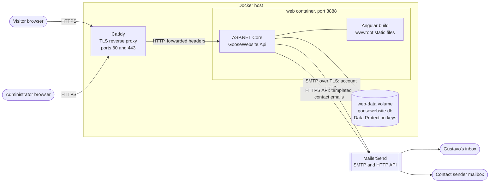
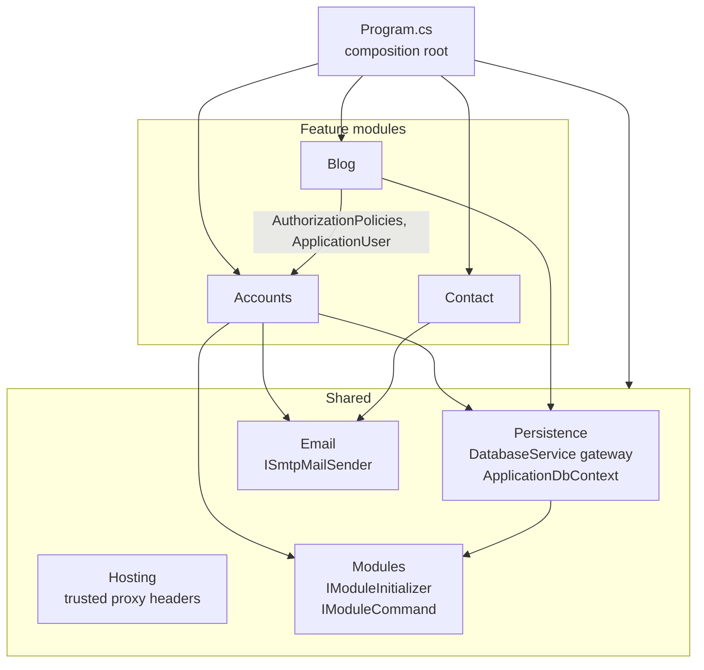
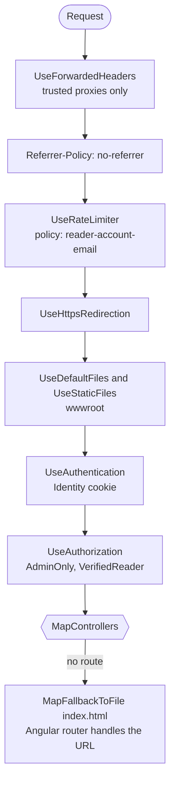
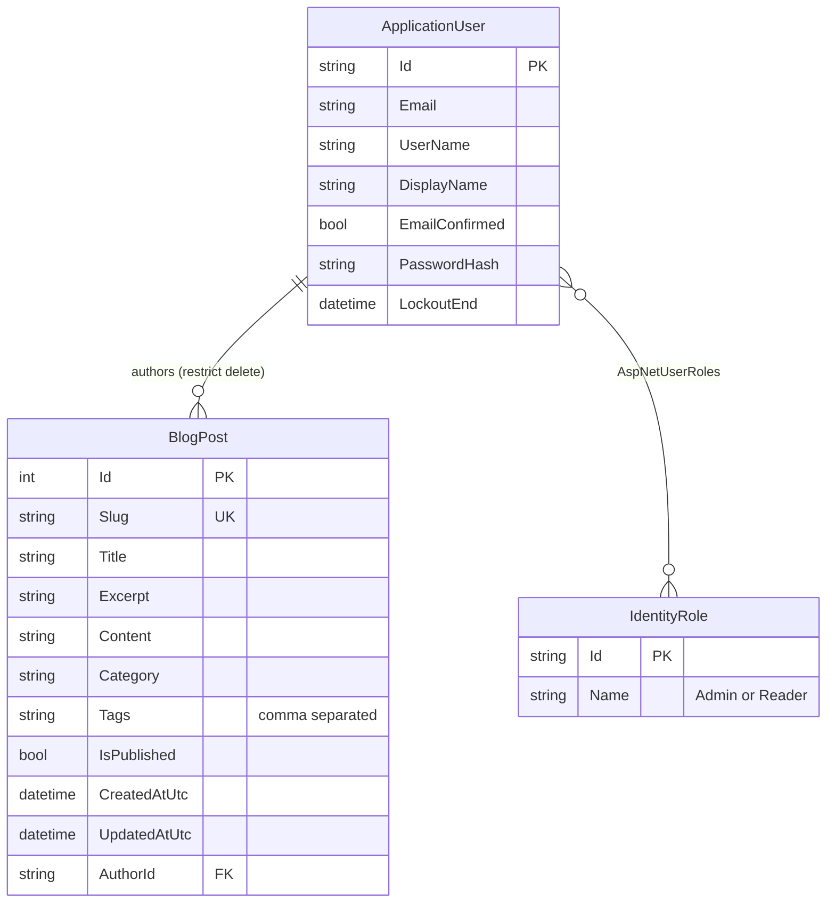
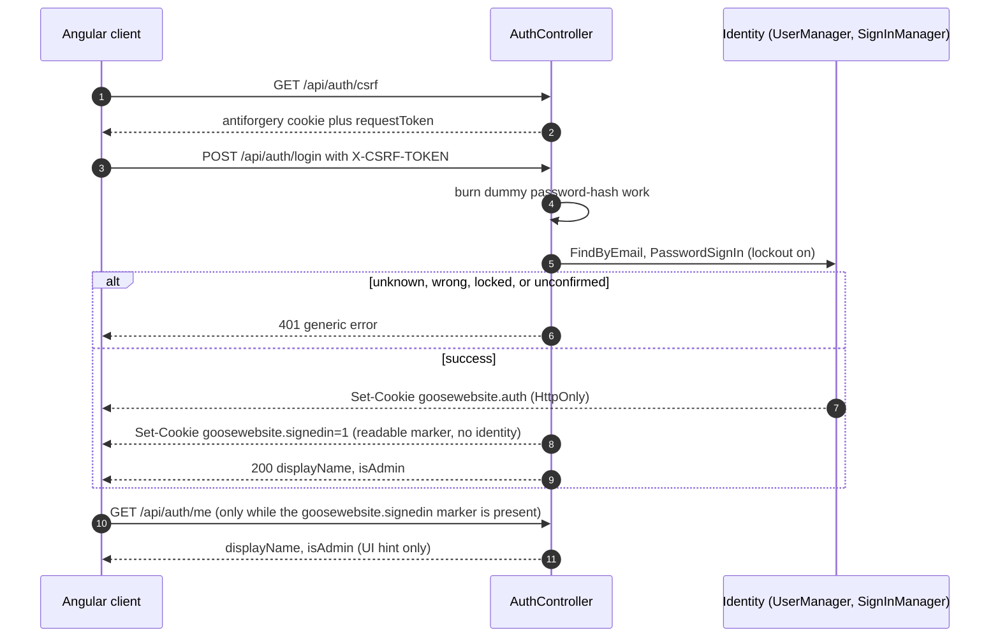
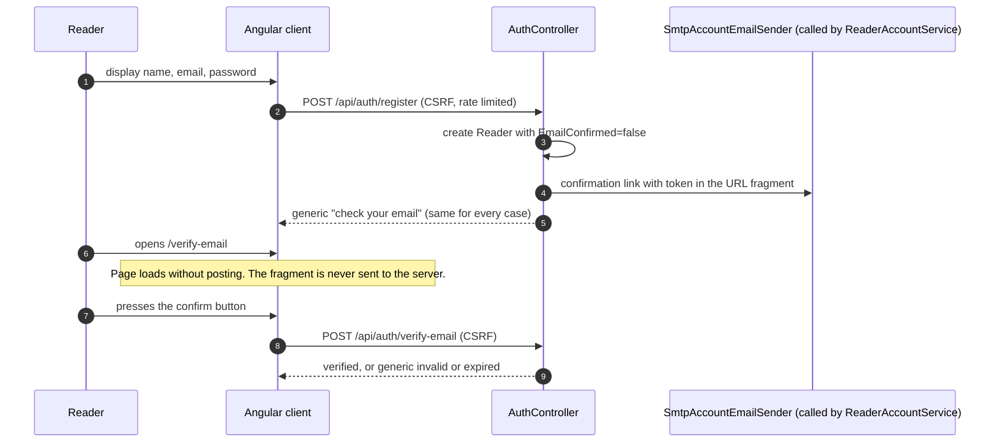
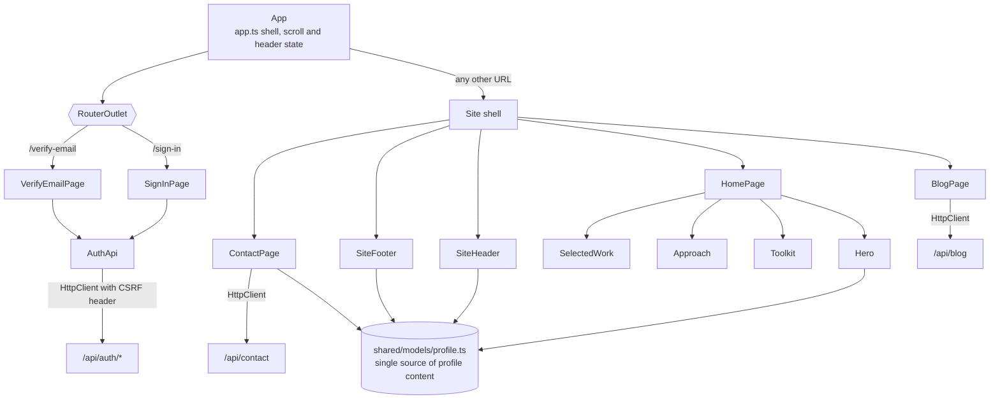
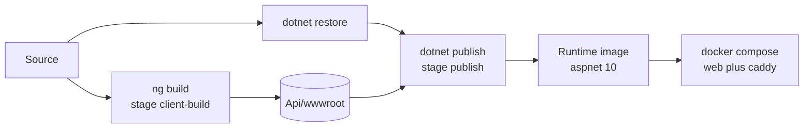

# GooseWebsite Architecture

**Audience:** AI agents and developers. Read this before implementing a feature or changing existing behavior.  
**Also for:** Gustavo, to see the product as it is built today. Diagrams are Mermaid and render in VS Code, GitHub, and most Markdown viewers.  
**Last verified against the code:** 2026-10-01

This document describes **what exists now**, not the target. For the target see [project.md](./project.md) and [product-backlog.md](./product-backlog.md). Where the code falls short of the target, section 11 lists the gap. Keep this file in the same change as any structural change.

Contents: [1 System](#1-system-context) · [2 Repository](#2-repository-layout) · [3 Backend](#3-backend-modules) · [4 Data](#4-data-model) · [5 Flows](#5-key-flows) · [6 Frontend](#6-frontend) · [7 Config and operations](#7-configuration-build-and-operations) · [8 Conventions](#8-conventions) · [9 Extending](#9-how-to-add-change-or-remove-a-feature) · [10 Testing](#10-testing) · [11 Known gaps](#11-known-gaps-and-technical-debt)

## 1. System context

One ASP.NET Core process serves both the JSON API and the compiled Angular client from a single origin. In Docker, Caddy terminates TLS in front of it. State is a SQLite file and a folder of Data Protection keys on one volume. Outbound mail goes through SMTP.



Runtime decisions that other code depends on:

- **Single origin.** The client calls relative `/api/...` URLs. There is no CORS configuration, and none should be added without a decision.
- **Trusted proxy only.** `X-Forwarded-For` and `X-Forwarded-Proto` are honored only from the addresses in `ForwardedHeaders:KnownProxies` (Caddy's fixed address in Compose). Client IP drives rate limiting, so never widen this.
- **Authorization lives in the API.** Angular route guards are conveniences only.

## 2. Repository layout

```text
GooseWebsite/
├── GooseWebsite.slnx                 Solution (API + tests)
├── Directory.Build.props             Shared .NET settings (net10.0, nullable, implicit usings)
├── Dockerfile                        Three stages: client build, .NET publish, runtime
├── docker-compose.yml                web + caddy, private network, one data volume
├── Caddyfile                         TLS reverse proxy to web:8888
├── .env.example                      Template for SMTP and domain settings (copy to .env)
├── CLAUDE.md                         Instructions for AI agents working in this repo
├── Docs/
│   ├── goal.md                       Executive purpose (the ultimate goal)
│   ├── project.md                    Scrum roadmap and high-level technical spec
│   ├── architecture.md               This file
│   ├── product-backlog.md            Stories and acceptance tests
│   ├── f3-authentication-architecture.md   Design record for accounts
│   ├── Api/GooseWebsite.http         Sample requests for the REST client
│   └── archive/                      Superseded documents
├── src/
│   ├── GooseWebsite.Api/             ASP.NET Core application
│   │   ├── Program.cs                Composition root, one line per module
│   │   ├── Modules/                  One folder per feature (section 3)
│   │   │   ├── Accounts/
│   │   │   ├── Blog/
│   │   │   ├── Contact/
│   │   │   ├── Media/
│   │   │   └── Projects/
│   │   ├── Shared/                   Cross-cutting infrastructure (section 3.2)
│   │   │   ├── Email/  Hosting/  Modules/  Persistence/
│   │   ├── Data/                     SQLite file for local development (git-ignored)
│   │   ├── data-protection-keys/     Local cookie-protection keys (git-ignored)
│   │   ├── wwwroot/                  Angular build output (git-ignored)
│   │   └── appsettings*.json
│   └── GooseWebsite.Client/          Angular application (section 6)
└── tests/
    └── GooseWebsite.Api.Tests/       xUnit tests (section 10)
```

Inside each backend module the folders mean the same thing everywhere:

| Folder | Holds |
| --- | --- |
| `Controllers/` | HTTP endpoints only: bind, authorize, call a service, map to a contract |
| `Contracts/` | Request and response DTOs that cross the HTTP boundary |
| `Domain/` | Entities, constants, and EF mapping owned by the module |
| `Services/` | Business logic, repositories, and adapters to outside systems |
| `Models/` | Internal types that never leave the module's services |
| `Authorization/` | Policies and handlers (Accounts only) |
| `<Name>Module.cs` | The single `Add<Name>Module` extension that registers everything above |

## 3. Backend modules

### 3.1 Dependency rules



- `Program.cs` may reference every module; modules never reference `Program`.
- **Contact** depends on `Shared` only. **Accounts** depends on `Shared`. **Media** depends on `Shared` only. **Blog** and **Projects** depend on `Shared` and on `Accounts` (for the author entity and the authorization policy names); they do not depend on each other. Do not add the reverse direction. If two modules need the same thing, move it into `Shared`.
- `Shared` never references a module, with one deliberate exception: `ApplicationDbContext` and `DatabaseService` know `ApplicationUser` from Accounts, because Identity shares the database. Every other module table is discovered through `IEntityTypeConfiguration<T>` without `Shared` naming it.
- **All database reads and writes go through `DatabaseService`.** A module keeps its own query logic in a service or repository (what to ask for) but calls the gateway (how to ask). Never inject `ApplicationDbContext`, `UserManager`, or `RoleManager` into a module class other than Identity registration. The sanitization, access rules and one-click-one-unit-of-work guarantee (F7-US1) are applied beneath the gateway, so they hold for every module; declare an `EntityAccessRule<T>` next to every new entity (see section 4).

### 3.2 Shared layer

| Component | What it does | Used by |
| --- | --- | --- |
| `Shared/Persistence/DatabaseService` | **The single gateway for every database read and write.** Generic entity access (`Read<T>`, `ReadForUpdate<T>`, `Add`, `Remove`, `SaveChangesAsync`, `CanConnectAsync`) plus the account store (users, roles). There is no find-by-key, because it would skip the read filters. Modules never use `ApplicationDbContext`, `UserManager`, or `RoleManager` directly (an architecture test enforces it). The safeguards live beneath it, in the context. | Accounts, Blog |
| `Shared/Persistence/ApplicationDbContext` | The EF Core context behind the gateway. Applies every `IEntityTypeConfiguration<T>` found in the assembly, builds each entity's read filter from its `EntityAccessRule<T>`, and runs `DataSafeguardsInterceptor` on every save. | `DatabaseService` only |
| `Shared/Persistence/PersistenceServiceCollectionExtensions` | `AddSharedPersistence`: registers SQLite and resolves a relative database path against the content root, so the working directory never matters | `Program.cs` |
| `Shared/Persistence/DatabaseInitializer` | First `IModuleInitializer`: applies EF Core migrations, adopting a database that `EnsureCreated` made earlier | startup |
| `Shared/Modules/IModuleInitializer` | A module's startup hook (for example, create roles). Run in registration order after the database exists. | Accounts, Persistence |
| `Shared/Modules/IModuleCommand` | A module's operator command-line entry point. If one handles the arguments, the web host does not start. | Accounts (`admin provision`, `admin reset-password`) |
| `Shared/Email/ISmtpMailSender` | The only class that talks to SMTP. Returns `false` and logs only the exception type on failure. | Accounts, Contact |
| `Shared/Email/IMailerSendClient` | The only class that talks to the MailerSend HTTP API. Sends one templated email (template id plus variables). Returns `false` and logs only the HTTP status code on failure. | Contact |
| `Shared/Hosting/AddTrustedProxyHeaders` | Forwarded-header trust from configuration | `Program.cs` |

Startup order in `Program.cs`: register shared services, register modules, build, run all `IModuleInitializer`s, offer the arguments to all `IModuleCommand`s, then configure the pipeline.

### 3.3 Request pipeline



### 3.4 Accounts module

Owns identity, sessions, and authorization. Source: `Modules/Accounts/`.

| Piece | File | Notes |
| --- | --- | --- |
| Registration of everything | `AccountsModule.cs` | Identity options, cookie, antiforgery, Data Protection, rate limit, policies |
| Roles | `Domain/AccountRoles.cs` | `Admin`, `Reader`. Server-managed; never accepted from a client |
| User entity | `Domain/ApplicationUser.cs` | Identity user plus `DisplayName` |
| Policies | `Authorization/AuthorizationPolicies.cs` | `AdminOnly`, `VerifiedReader`. Other modules reference these constants |
| Live verification check | `Authorization/VerifiedReaderAuthorizationHandler.cs` | Reads `EmailConfirmed` and role from the database on every call, so a stale cookie cannot authorize |
| Endpoints | `Controllers/AuthController.cs` | See the table below |
| Role seeding | `Services/AccountRoleInitializer.cs` | Creates missing roles at startup, never users |
| Admin provisioning | `Services/AdminProvisioningService.cs`, `AdminProvisioningCommand.cs` | Interactive operator command; refuses existing accounts; never promotes a user |
| Reader accounts | `Services/IReaderAccountService.cs`, `ReaderAccountService.cs` | Registration, resend and email Verification return neutral outcomes (the controller maps them), so nothing reveals whether an address has an account. A role assignment that fails (or throws because the role is missing) removes the new account again |
| Verification email | `Services/IAccountEmailSender.cs`, `SmtpAccountEmailSender.cs`, `AccountVerificationEmailRenderer.cs` | Separate from contact delivery on purpose. Sends a multipart message: branded HTML (tables and inline styles, no remote resources except the logo at `{PublicBaseUrl}/email/gcv-logo.png`, built with `PublicLinkBuilder.SiteLink`) plus a plain-text alternative. The display name is HTML-encoded in the HTML view. See `Docs/email-templates/README.md` |

Security settings in force: unique email, password minimum 12 characters with no composition rule, lockout after 5 failures for 15 minutes, email confirmation required to sign in, confirmation token lifetime 24 hours, cookie `goosewebsite.auth` (HttpOnly, SameSite=Lax, Secure always in Production, 30-minute sliding expiry, not persistent), antiforgery cookie `goosewebsite.csrf` with header `X-CSRF-TOKEN`. A sign-in marker cookie `goosewebsite.signedin` (F9-US7) is set with the value `1` when sign-in succeeds and cleared at sign-out; it is the one cookie that is deliberately not HttpOnly (Secure, SameSite=Lax, path `/`, no expiry, no identity or token in it) because the client reads it to decide whether to call `GET /api/auth/me`; it is a hint only and grants nothing. Cookie events return 401 and 403 rather than redirecting. Signing out also rotates the account's security stamp, so a session cookie captured before sign-out stops working too (cookies are checked against the stamp on every request).

| Endpoint | Auth | Purpose |
| --- | --- | --- |
| `GET /api/auth/csrf` | anonymous | Issue antiforgery cookie and request token |
| `GET /api/auth/reader-registration` | anonymous | Whether reader registration is enabled |
| `POST /api/auth/login` | anonymous, CSRF | Sign in; same generic error for unknown, wrong, locked, or unconfirmed |
| `POST /api/auth/logout` | signed in, CSRF | Sign out |
| `GET /api/auth/me` | signed in | Display name and server-derived `isAdmin` (the client calls it only while the sign-in marker cookie is present) |
| `POST /api/auth/register` | anonymous, CSRF, rate limited | Create unconfirmed Reader; always the same response. Returns 404 unless `Auth:ReaderRegistration:Enabled` is true |
| `POST /api/auth/verification/resend` | anonymous, CSRF, rate limited | Resend confirmation; generic response |
| `POST /api/auth/verify-email` | anonymous, CSRF, rate limited | Confirm with `userId` and `token` from the link |

### 3.5 Contact module

Owns the public contact form. Source: `Modules/Contact/`. It keeps no durable data.

| Piece | File | Notes |
| --- | --- | --- |
| Registration | `ContactModule.cs` | Binds `ContactOptions`; singletons for the token store and abuse guard; the module interface `IContactSubmissionService` |
| Module interface | `Services/IContactSubmissionService.cs`, implemented by `Services/ContactSubmissionService.cs` | `SubmitAsync(message, clientKey)` and `VerifyAsync(token)` return outcomes (`ContactSubmitStatus`, `ContactVerifyStatus`). It owns the order of checks, discarding a Pending message when the link cannot be sent, restoring it after a failed delivery (remembering that Gustavo was already notified), and the logging policy |
| Endpoints | `Controllers/ContactController.cs` | Maps outcomes to status codes only. `POST /api/contact` (emails the link to the sender), `POST /api/contact/verify` (body `{token}`; the emailed link opens the client page `/contact/verify#token=...`) |
| Abuse guard | `Services/ContactSubmissionAbuseGuard.cs` | Thread-safe sliding windows in two separate bounded stores: per socket IP, and per submitted address (stored only as a SHA-256 hash, case-insensitive). Configured under `Contact:RateLimit` |
| Pending store | `Services/ContactVerificationService.cs` | In-memory, 30-minute lifetime, single use, removed on use or expiry |
| Delivery | `Services/ContactEmailDeliveryService.cs` | Three MailerSend templates through `IMailerSendClient`: the confirm link to the sender, then the notice to Gustavo, then the receipt to the sender. Template ids come from `Contact:Templates`; the variables each template needs are in `Models/ContactEmailTemplateVariables.cs` and pinned by `ContactEmailTemplateTests` |

Validation on `POST /api/contact` (performed by `ContactSubmissionService`, which the controller calls): honeypot field `website` must be empty, all four fields required, `reason` must be `Work or collaboration` or `Personal note`, email must be well formed, then the rate limit applies (HTTP 429 before any token is created). Logs carry the reason and a client key, never the sender's address or the message body.

### 3.6 Blog module

Owns stories (the product name; the code keeps its historical "blog post" name, table `BlogPosts` and route `/api/blog`). Source: `Modules/Blog/`. A story body is Markdown, shown safely; drafts are never public.

| Endpoint | Auth | Purpose |
| --- | --- | --- |
| `GET /api/blog?search&category&page&pageSize` | public | Published stories only, newest publication date first; page size clamped to 50 |
| `GET /api/blog/{slug}` | public | One published story (a draft is a 404) |
| `GET /api/editor/stories` | `AdminOnly` | The workspace list: every story, drafts included, without the body |
| `GET /api/editor/stories/{id}` | `AdminOnly` | One story in full, drafts included (the preview source) |
| `POST /api/editor/stories` | `AdminOnly`, CSRF | Create a **draft** (always a draft, whatever the request says); records the author and makes a unique slug |
| `PUT /api/editor/stories/{id}` | `AdminOnly`, CSRF | Save edits. Never publishes or unpublishes, never changes the slug; may set the publication date |
| `POST /api/editor/stories/{id}/publish` | `AdminOnly`, CSRF | Publish once: needs an excerpt and text; records the publication date if there is none; repeating changes nothing |
| `POST /api/editor/stories/{id}/unpublish` | `AdminOnly`, CSRF | Return to draft, keeping the publication date |
| `DELETE /api/editor/stories/{id}` | `AdminOnly`, CSRF | Delete for good |

`BlogController` (public reads) and `StoryEditorController` (everything that changes or lists drafts) are thin: the rules live in `IBlogAuthoringService` (`BlogAuthoringService`, TE9), which returns an outcome (`Succeeded`, `NotFound`, `Invalid` with the failing fields) that the controller maps to a response. The service owns: the slug (made from the title with letters and digits only, accents dropped, `story` when nothing is left, numeric suffix on a collision, never changed afterwards so links stay stable), the tags (trimmed, no empty tags, no duplicates that differ only in case, no commas inside a tag), the timestamps, and the rules for publishing. Saving a draft needs only a title; publishing needs an excerpt and text. Query logic is in `IBlogPostRepository` (`BlogPostRepository`), which reads and writes only through `DatabaseService`; the access rule (everybody reads published stories, administrators read drafts and write, no length limit) is `Domain/BlogPostAccessRule.cs` and the table mapping `Domain/BlogPostConfiguration.cs`. Stories published before `PublishedAtUtc` existed received their creation date in the `AddStoryPublishedAt` migration.

In the client (`app/features/editor/`, loaded on demand so visitors never download it) `StoryFormPage` is the form: save draft, preview (Markdown rendered by `markdown-it` with raw HTML off), publish, return to draft, with the status written in words.

### 3.6a Projects module

Owns projects (title, overview in Markdown, Gustavo's contribution, technologies, optional demo and source links). Source: `Modules/Projects/`. It follows the same pattern as stories: drafts are never public, saving never publishes, and publishing is explicit.

| Method and path | Who | What |
| --- | --- | --- |
| `GET /api/projects`, `GET /api/projects/{slug}` | Everyone | Published projects only (a draft is a 404) |
| `GET /api/editor/projects`, `GET /api/editor/projects/{id}` | Administrator | List (summaries) and open any project, drafts included |
| `POST /api/editor/projects`, `PUT /api/editor/projects/{id}` | Administrator + CSRF | Create or save; always leaves the state as it was (new = draft) |
| `POST /api/editor/projects/{id}/publish`, `.../unpublish` | Administrator + CSRF | Explicit state changes; publishing needs an overview and is idempotent |
| `DELETE /api/editor/projects/{id}` | Administrator + CSRF | Removes the project |

`IProjectAuthoringService` owns the rules (title required; links optional but only absolute `http` or `https` addresses; technologies trimmed, de-duplicated by case, no commas; slug from `Shared/Text/Slug` fixed at creation with a numeric suffix on a collision; publication date set at first publish). Queries are in `IProjectRepository`; the access rule is `Domain/ProjectAccessRule.cs`; table `Projects` (migration `AddProjects`). The client has `ProjectFormPage` and `ProjectApi` beside the story ones, and the workspace (`EditorPage`) switches between the two lists.

### 3.6b Media module

Owns image uploads (F4-US5). Source: `Modules/Media/`. Files live in `Media:Directory` (`/data/uploads` in Docker, `uploaded-images` beside the app in development) under generated names; table `ContentImages` records them (readable by administrators only).

| Method and path | Who | What |
| --- | --- | --- |
| `POST /api/editor/images` | Administrator + CSRF | Multipart upload of one file; JPEG, PNG, WebP or GIF by its first bytes, at most 5 MB (413 over); returns the reference `/uploads/<name>` |
| `GET /api/editor/images` | Administrator | Lists uploaded images |
| `DELETE /api/editor/images/{id}` | Administrator + CSRF | Removes the row and the file |
| `GET /uploads/<name>` | Everyone | Static file, `nosniff`; only files the module wrote exist |

Stories and projects store only a reference of the form `/uploads/<32 hex>.<jpg|png|webp|gif>` (`Shared/Text/UploadedImageReference` checks it), so they do not depend on this module. Unreferenced images are kept until Gustavo deletes them. Deleting an image does not check whether a story or project still uses it (known gap, found in review; it matters once a screen for deleting images exists, and a cover is checked only for its form, not for the file existing). The client has `ImageApi` and the `ImageControls` component used by both forms.

### 3.7 Authorization matrix

| Operation | Anonymous | Reader, unconfirmed | Reader, confirmed | Admin |
| --- | --- | --- | --- | --- |
| Read published blog posts | yes | yes | yes | yes |
| Submit contact form | yes (rate limited) | yes | yes | yes |
| Create, update, delete posts | no (401) | no (cannot sign in) | no (403) | yes |
| Comment actions (R3, `VerifiedReader`) | no | no | yes | not by role alone |

## 4. Data model



Identity also creates its standard claim, login, and token tables; they are omitted here. Contact messages are **not** stored. The pending verification dictionary exists only in process memory.

The schema is built by EF Core migrations (`Shared/Persistence/Migrations/`), applied at startup by `DatabaseInitializer`. A database created before migrations existed (by `EnsureCreated`) has no migration history; the initializer records the first migration (`InitialCreate`) as applied and leaves its data alone. The baseline assumes that database matches the model as of `InitialCreate`; if the key tables are missing, startup stops with an error instead of adopting it. Copy `goosewebsite.db` before the first start of a version that applies a migration to real data. Add a change with `dotnet dotnet-ef migrations add <Name> --project src/GooseWebsite.Api --output-dir Shared/Persistence/Migrations` (the tool is pinned in `dotnet-tools.json`; run `dotnet tool restore` once). `DatabaseInitializerTests` fails if the model and the migrations disagree.

### Data access safeguards (F7-US1)

The rules are beneath `DatabaseService`, in `Shared/Persistence`, where no caller can switch them off. Each entity declares an `EntityAccessRule<T>` next to its mapping (found by assembly scan, like the configurations); an architecture test fails if an entity has none or if a module mentions the context, the Identity managers, `IgnoreQueryFilters`, `ExecuteUpdate`, `ExecuteDelete`, `FromSql` or `ExecuteSql` (the set-based and raw-SQL calls would skip the write checks).

| Piece | Behavior |
| --- | --- |
| Caller (`ICurrentCaller`) | For a web request: the signed-in user from the session cookie (`Anonymous`, `Authenticated` Reader, `Administrator`). Outside a request (startup, migrations, operator commands): `System`. Modules never pass identity by hand |
| Read | A rule can name the rows everybody may read (`VisibleWhen`). Administrators and the system read all rows. Blog posts: everybody reads published posts, drafts only administrators. Implemented as an EF query filter, so every query obeys it |
| Write | `WriteAccess.Administrator` (blog posts), `Anyone` (Identity tables and users: written by the Identity managers, including for anonymous visitors who register or fail a sign-in), `System`. A refused write throws `DataAccessDeniedException`; no rule at all is refused for everyone but the system |
| Text | Properties declared `IsUserText` are trimmed and cleaned of control characters (line breaks and tabs stay); a declared `maxLength` rejects longer text with `DataRejectedException`. Blog posts have no limit (only Gustavo writes); a user's display name is limited to 100; comments will be limited to 500 (F6-US1) |
| Answers | `DataSafeguardExceptionHandler` maps the exceptions to 403 and 400 with fixed messages that never echo what was submitted. Hidden rows simply do not exist for the caller (a draft is a 404). Logs carry the kind of refusal, the entity and the caller kind, never values |
| One click, one unit of work | The first save inside a web request opens a transaction; `UnitOfWorkFilter` commits it when the action finishes normally and rolls it back when the action throws (a refused write included), so nothing from a failed click persists. An answer with a failure status (a 401 after a wrong password) is not an exception: the failed-attempt counter it saved is kept. A refused or failed save marks the click failed even if the code caught the exception and answered normally. `UnitOfWorkMiddleware` completes saves made outside an action (middleware, minimal endpoints). Commit and rollback ignore a client that disconnects |

### Editor access (F4-US2)

Who may change content is decided in the API, never in the page. Every blog write carries `[Authorize(Policy = AdminOnly)]` and `[ValidateAntiForgeryToken]`; the data layer refuses a non-administrator write again beneath it (F7-US1). `DataAccessArchitectureTests` fails if any controller write action lacks `[Authorize]` or `[AllowAnonymous]` (the public contact form says `[AllowAnonymous]` on purpose), or if a signed-in write lacks the anti-forgery attribute, so a future endpoint cannot ship open. `EditorAccessTests` runs create, update and delete for an anonymous caller (401), a Reader (403), an expired session (401) and an administrator, and asserts the stored content.

The client mirrors this only to spare people a page they cannot use: `/editor` is behind `editorGuard`, the public header shows an "Editor" link to administrators only, and `sessionInterceptor` handles the CSRF token and the "session expired" case. Sign-in returns to the page the person came from only when `safeReturnUrl` accepts it (a path on this site).

## 5. Key flows

### 5.1 Sign-in with CSRF protection



### 5.2 Contact message

The link is emailed to the submitted address and never returned to the browser, so only the owner of that inbox can confirm it. Confirmation is an explicit POST from the client page, so mail link scanners that fetch the URL cannot trigger delivery.

```mermaid
sequenceDiagram
    autonumber
    participant B as Angular client
    participant C as ContactController (maps outcomes; the module in `ContactSubmissionService` runs the steps below)
    participant G as AbuseGuard
    participant V as VerificationService (memory)
    participant D as DeliveryService
    participant S as MailerSend API

    B->>C: POST /api/contact {name, email, reason, message, website}
    C->>C: honeypot, required fields, reason, email format
    C->>G: TryAllow(client IP)
    alt over the limit
        C-->>B: 429
    else allowed
        C->>V: CreateVerification (30 minute token)
        C->>D: SendVerificationRequestAsync (link only, no message body)
        D->>S: confirmation template to the sender
        alt email failed
            C->>V: Discard(token)
            C-->>B: 502
        else sent
            C-->>B: 200 verificationRequired (no token or URL)
        end
    end
    Note over B: Sender opens /contact/verify#token=... and presses Confirm
    B->>C: POST /api/contact/verify {token}
    C->>V: Verify (single use)
    alt invalid, expired, or reused
        C-->>B: 400, 410, or 409
    else valid
        C->>D: SendAsync(pending message)
        D->>S: owner template to Gustavo, then receipt template to the sender
        C-->>B: 200, or 502 if delivery failed
    end
```

### 5.3 Reader registration and verification (built, disabled by default)



## 6. Frontend

Angular 20 with standalone components, signals, SCSS, and the built-in router. Source: `src/GooseWebsite.Client/src/app/`.



| Folder | Holds |
| --- | --- |
| `app/features/auth/` | `api/` (AuthApi with CSRF handling, and `session-marker.ts`: `getCurrentUser()` makes no request without the sign-in marker and clears the marker when the API answers 401), `models/`, `pages/` (sign-in, verify-email). Authentication pages hide the public shell. |
| `app/features/editor/` | The editor workspace (`EditorPage`: stories with status filter, title search and confirmed deletion), the story form (`pages/story-form-page`), `StoryApi`, `editorGuard` (administrator in; Reader to `/access-denied`; not signed in to `/sign-in?returnUrl=`) and the no-access page. Standalone routes, like the authentication pages |
| `app/shared/http/` | `sessionInterceptor`: gives every non-GET request to `/api/` the CSRF token and, when a non-auth API call answers 401, sends the person to sign in with `reason=session-expired` and the page they were on |
| `app/features/home/` | The home page and its sections, all built from the design tokens: `hero` and `categories` over the animated scene, `approach` (About, with the portrait), `selected-work` (Projects: published projects from `/api/projects` as `ProjectPanel`s), `toolkit` (Skills). Stories (`features/blog`) and Contact (`features/contact`) follow, then the footer |
| `app/features/blog/`, `app/features/contact/` | Self-contained feature components with their own template and styles |
| `app/layout/` | `site-header`, `site-footer` |
| `app/shared/` | `models/` (profile, navigation item), `styles/site.scss` shared layout rules |
| `src/styles.scss` | Global design tokens and font families |

The public site is one long page with anchors (`home`, `work`, `approach`, `blog`, `contact`); only the authentication screens are routed URLs. The client keeps the CSRF token in memory and requests a fresh one before each mutation (`AuthApi.postWithCsrf`). The contact form and blog section call the API with plain `HttpClient`.

Build facts: output goes to `../GooseWebsite.Api/wwwroot`; production budgets warn at 500 kB and fail at 1 MB for the initial bundle; `ng serve` proxies `/api` to `https://localhost:8889` through `proxy.conf.json`.

### 6.1 Design system (F9-US1)

Direction (Gustavo, 2026-10-16): a mostly black/charcoal interface that stays extremely clean, with electric cyan as the main accent and magenta as the small secondary one; the artwork carries the visual complexity. The category cards keep their own green (Security) and orange (Systems & Tools) accents. Source material is in `Docs/Inspirations/`.

- **Tokens** are CSS custom properties in `app/shared/styles/tokens.scss`, all named `--gcv-*`: surfaces (`bg-0..2`, `line`), text (`text`, `text-muted`, `text-faint`), accents (`cyan`, `magenta`, `violet`, `green`, `orange`), type (families Michroma / DM Sans / JetBrains Mono, a size scale, tracking), space (4 px base), shape (`radius-card`, `bracket-size`), motion (`motion-fast/base/slow`, which become instant under `prefers-reduced-motion`) and focus. The file records how each value traces to `LandingPageInspiration.png`. The old names (`--paper`, `--accent`...) remain as aliases so earlier screens already follow the palette; they are removed once F9-US2 to F9-US5 have moved every screen to the `gcv` names. **Rule: no screen uses a colour, font, size or spacing literal; it uses a token.**
- **Base components** are global classes in `app/shared/styles/components.scss`: `gcv-eyebrow`, `gcv-heading` (with `--hero`, `--section`, `--card`; an `<em>` inside gets the cyan-to-white gradient), `gcv-label`, `gcv-link`, `gcv-btn` (corner brackets; `--solid`), `gcv-field`, `gcv-chip`, `gcv-rule`, and one site-wide visible focus style.
- **Angular brand components** in `app/shared/brand/`: `BrandLogo` (resized WebP copies of the supplied raster logo: `public/brand/gcv-logo-192.webp` and `-512.webp`; descriptive alt text; never below 48 px; clear space equal to half its height), `ArtScene` and `ProjectPanel` (a "system diagnostic" panel: picture or GIF, technology stack, and a VIEW CASE control that opens the case in place with the demo and source links and a link to `/projects/<slug>`, the full post built by F5-US1).
- **React island.** The animated hero scene (from `Docs/Inspirations/cyberpunk-react-loop`) is a React component in `client/art/`, built by Vite (`npm run build:art`, run automatically before `npm run build` and `npm start`) into `public/art/gcv-scene.js` (git-ignored, about 85 kB compressed), which defines the `<gcv-scene>` custom element in a shadow root. `ArtScene` loads that script the first time a page needs it, so pages without the scene never download React. The scene lays its effects on a 3:2 "stage" sized to cover the area (so every effect stays on the right part of the art at any screen shape): shifting sky light and drifting clouds, four ships crossing the skyline continuously at different heights and speeds, a pulsing terminal glow with scrolling scanlines and a sweep fitted to the laptop screen, flickering neon signs (the koi tower, the kanji signs), drifting haze, and a slow camera breath; React adds a gentle pointer parallax (skipped on touch screens). On phones the focus moves to the figure and laptop and a 960 px image is used. The scene is decoration (hidden from assistive technology, no pointer input), and every animation, the ships and the parallax stop under `prefers-reduced-motion`. On the home page the scene runs from the top of the page to just behind the top of the category cards and fades out there (a mask on the element; `--scene-fade-start` sets where the fade begins). The hero artwork is `public/brand/hero-city.webp` (and a 960 px copy for narrow screens), optimized from the supplied PNG (2.3 MB to 207 kB). Future React-only animation goes in `client/art/` the same way. React is used only there; the application stays Angular.
- **Review page.** `/design` (`features/design/design-page.ts`) shows every token and component with the scene and a sample project panel, for Gustavo's approval. It holds sample content and is removed before R1 ships (with TE4).
## 7. Configuration, build, and operations

### 7.1 Configuration reference

Configuration binds in this order of precedence, last wins: `appsettings.json`, `appsettings.{Environment}.json`, user-secrets (Development only), environment variables. Nested keys use `__` in environment variables (`Email__Smtp__Host`).

| Key | Purpose | Default |
| --- | --- | --- |
| `ConnectionStrings:Default` | SQLite database; a relative path resolves against the project folder | `Data Source=Data/goosewebsite.db` |
| `Email:Smtp:Host`, `Port`, `Username`, `Password`, `FromEmail`, `FromName` | The shared SMTP sender. **Secrets: user-secrets or environment only** | empty; mail is skipped with a warning |
| `MailerSend:ApiKey`, `FromEmail`, `FromName` | MailerSend HTTP API for the templated contact emails. **The API key is a secret: user-secrets or environment only** (Docker: `MAILERSEND_API_KEY`, sender defaults to `SMTP_FROM_EMAIL`) | empty; contact emails are not sent |
| `Contact:Templates:SenderConfirmation`, `SenderReceipt`, `OwnerNotification` | MailerSend template ids (identifiers, not secrets) | the three ids in `appsettings.json` |
| `Contact:LogoUrl` | Public address of the email logo | `{PublicBaseUrl}/email/gcv-logo.png` |
| `Contact:RecipientEmail` | Inbox for verified contact messages | empty; delivery is skipped |
| `Contact:RateLimit:MaxRequestsPerWindow`, `WindowMinutes`, `MaxTrackedClients`, `MaxRequestsPerRecipient` | Contact abuse guard | 5, 10, 10000, 2 |
| `Auth:ReaderRegistration:Enabled` | Reader registration endpoints | `false`; `true` in Development |
| `PublicBaseUrl` | Base for links in emails. Verification links for both Contact and Accounts are built by `Shared/Hosting/PublicLinkBuilder` (values go in the URL fragment); the Contact email also reads it for the plain site address and logo URL | `https://localhost` |
| `HSTS_MAX_AGE` | Seconds of the `Strict-Transport-Security` header sent by Caddy. Short by default so a local browser is not pinned to HTTPS; raise it once the site has a real domain | `300` |
| `DataProtection:KeysPath` | Cookie-key folder; must persist across restarts | `data-protection-keys` next to the project |
| `ForwardedHeaders:KnownProxies:N` | Trusted proxy IP addresses | none |

Set development secrets with `dotnet user-secrets` from `src/GooseWebsite.Api` (id `goosewebsite-api`), for example `dotnet user-secrets set "Email:Smtp:Password" "<value>"`. For Docker, copy `.env.example` to `.env`. Never commit either.

### 7.2 Build and run

| Task | Command |
| --- | --- |
| Run API (serves built client) | `dotnet run --project src/GooseWebsite.Api` (HTTPS on 8889, HTTP 8888 redirects) |
| Build client | `npm ci` then `npm run build` in `src/GooseWebsite.Client` |
| Client dev server with proxy | `npm start` in `src/GooseWebsite.Client` |
| Run all .NET tests | `dotnet test GooseWebsite.slnx -p:SkipClientBuild=true` |
| Run client tests | `npm test -- --watch=false --browsers=ChromeHeadless` |
| Provision an administrator | `dotnet run --project src/GooseWebsite.Api -- admin provision` |
| Reset an administrator's password | `dotnet run --project src/GooseWebsite.Api -- admin reset-password` (existing administrators only; ends their sessions and clears any lockout) |
| Container stack | `docker compose up --build -d` (site at `https://localhost`) |

The API project's `BuildClient` target runs `npm run build` before every build unless `-p:SkipClientBuild=true` is passed. Some integration tests request `/verify-email` and expect the SPA fallback, so build the client at least once first.



### 7.3 Operations

- **State to back up:** the `web-data` volume (`/data/goosewebsite.db` and `/data/keys`). Losing the keys signs everyone out; losing the database loses accounts and posts.
- **TLS:** Caddy uses its local CA for `localhost`. To trust it on Windows, export the root with `docker compose cp caddy:/data/caddy/pki/authorities/local/root.crt ./certs/caddy-root.crt` and import it into the current user's trusted roots. For a public site set `SITE_DOMAIN` to a real DNS name that points at the host with ports 80 and 443 open, and Caddy obtains a certificate automatically. Do not share the CA key held in the `caddy-data` volume.
- **TLS and the container's HTTP port:** the browser always talks to Caddy over HTTPS (port 443; port 80 redirects). Caddy terminates TLS with a certificate from its own local CA and forwards to the app container over the private Docker network, so the app's `Now listening on http://[::]:8888` log line is expected: port 8888 is not published to the host. Production will replace the local CA with a public one by setting `SITE_DOMAIN` to a real DNS name.
- **Trusting the local CA:** the CA lives in the `goosewebsite_caddy-data` volume, so it survives restarts but a new volume (for example after a project rename or `docker compose down -v`) creates a new CA that the machine does not trust, and the browser shows a certificate error. After that, export the root with `docker cp goosewebsite-caddy:/data/caddy/pki/authorities/local/root.crt certs/caddy-root.crt`, import it with `certutil -user -addstore Root certs\caddy-root.crt` (Windows asks for confirmation), and remove the stale root with `certutil -user -delstore Root <old thumbprint>`. Compare `openssl x509 -in certs/caddy-root.crt -noout -fingerprint -sha256` with what is trusted.
- **Renamed volumes:** the Compose project is `goosewebsite` (containers `goosewebsite-web` and `goosewebsite-caddy`, image `goosewebsite-web`, volumes `goosewebsite_web-data`, `goosewebsite_caddy-data`, `goosewebsite_caddy-config`, network `goosewebsite_app-private`). Stacks created under the earlier names `testwebsite` (volume `testwebsite_portfolio-data`, database `testwebsite.db`) or `vaninwebsite` (database `vaninwebsite.db`) keep their data in the old volumes. To keep it, stop the old stack with `docker compose -p testwebsite down` (or `-p vaninwebsite`) (never `-v`), copy the old volume's contents into `goosewebsite_web-data`, and rename the database file to `goosewebsite.db*`. An old stack left running also blocks the new one, because it holds ports 80 and 443 and the `172.30.100.0/24` subnet.
- **Logging policy:** log categories and counts only. Never log message bodies, email addresses, tokens, or passwords. Keep this when adding log lines.
- **Mail troubleshooting:** the API logs `SMTP delivery failed` with the exception type and SMTP status code. `smtpStatusCode=MustIssueStartTlsFirst` is .NET's name for any 530 reply, and it usually means the provider rejected the credentials (a `535` on AUTH). Confirm with a handshake that sends no data: `openssl s_client -connect smtp.mailersend.net:587 -starttls smtp -crlf -quiet`, then `EHLO`, `AUTH PLAIN <base64 of \0user\0pass>`, `MAIL FROM`, `RCPT TO`, `QUIT`. `235` means the credentials work. For a MailerSend trial domain, send from an address on that domain.

## 8. Conventions

- **Layout:** one module per feature under `Modules/<Name>/`, folders as in section 2. Namespaces match folders (`GooseWebsite.Api.Modules.<Name>.<Folder>`).
- **Registration:** every module exposes exactly one `Add<Name>Module(...)` extension and is wired by one line in `Program.cs`. Startup work goes in an `IModuleInitializer`; operator commands go in an `IModuleCommand`.
- **Persistence:** entities and their `IEntityTypeConfiguration<T>` live in the owning module. Query logic lives in an interface in the module's `Services/`, and every read or write goes through `DatabaseService`. Controllers and modules do not use the context or Identity managers directly. Add a generic method to `DatabaseService` rather than bypassing it, and declare the entity's `EntityAccessRule<T>` in the same module.
- **Contracts:** never return an entity from an endpoint. Use a request and response type in `Contracts/` with validation attributes. Never bind privilege-bearing fields (role, `EmailConfirmed`, ids of other users) from a request.
- **Authorization:** protect every write with a policy from `AuthorizationPolicies`, not bare `[Authorize]`, and add `[ValidateAntiForgeryToken]` to cookie-authenticated mutations.
- **Configuration:** bind settings to an options class (see `SmtpOptions`, `ContactOptions`). Do not read `IConfiguration` ad hoc in new code, and never hard-code addresses or credentials.
- **Mail:** account emails are built in the module and sent through `ISmtpMailSender`. Contact emails are MailerSend templates sent through `IMailerSendClient`: the module picks the template id and supplies every variable it reads (case-sensitive names, constants in `ContactEmailTemplateVariables`), and a test pins them. A variable the request omits renders as its own name in the inbox.
- **Style:** C# with nullable references enabled, file-scoped namespaces, primary constructors for dependency injection, `sealed` classes by default, a short comment saying why a type exists. TypeScript uses standalone components, signals, and typed models; one feature per folder under `app/features/`.
- **Naming:** `I<Name>` for seams, `<Name>Module`, `<Name>Controller`, `<Name>Repository`, `<Name>Configuration` for EF mappings.

### 8.1 Pitfalls found in review (do not repeat)

Each item is a defect that a code review found in this repository. Check new code against the list before it is committed.

| Pitfall | What went wrong (found 2026-10-02, F2-US2) | Rule |
| --- | --- | --- |
| Consuming a one-time token before the side effect succeeds | `Verify` removed the token, then delivery to Gustavo failed. The client was told to try again, but the retry was rejected and the message was lost | If a failure response tells the caller to retry, the retry must work. Restore the state (`Restore`) or consume the token only after the side effect succeeds. Test the failure, then the retry |
| A public endpoint that emails a caller-supplied address | The contact form emailed any address, limited only per IP, so it could flood a third party from Gustavo's sender | Rate limit by the target address as well as the caller. Keep only a hash of the address. Test the limit, and that a different address is unaffected |
| Cleanup skipped on an exception | Pending data was discarded only when the send returned `false`, not when the mail library threw on a malformed address | Treat exceptions from the mail library as failed sends, and clean up in the same path. Test the throwing case |
| Returning secrets to the caller | The verification token and URL were returned in the API response, so anyone could verify any address | The token goes only to the channel it proves, such as the inbox. An API test must assert it is absent from the response body |
| State change on `GET` | A verify link that changed state would be triggered by mail scanners | State changes use `POST` after an explicit user action |
| Secrets or mail settings in `appsettings.json` | Working MailerSend credentials were placed in `appsettings.json` under a `MailerSend:Smtp` section the code never reads, while the values the app did read (user-secrets) were stale, so every send failed with `535` | Mail settings live only under `Email:Smtp:*` in user-secrets or environment variables, never in a tracked file (CLAUDE.md rule 4). When a setting seems ignored, check the key name against `SmtpOptions.SectionName` |
| Logging only the exception type for a failure | `SmtpException` alone hid the cause, and .NET reports every SMTP 530 reply as `MustIssueStartTlsFirst`, which misled the diagnosis | Log safe categories that identify the cause (exception type, SMTP status code). To diagnose an SMTP failure, replay the handshake (EHLO, AUTH, MAIL FROM, RCPT TO) without sending data |
| Template variables that do not match the request | A MailerSend template renders any variable the request omits (or spells differently) as its own name, for example `{{name}}` | Keep the variable names in one constants class, document them next to the templates, and pin them with a test that checks every variable for every template. Variable names in the MailerSend editor must be copied exactly |
| Check-then-act on a one-time token | `Verify` looked the token up, then removed it, so two simultaneous confirmations both succeeded and the message was delivered twice | Claim the token with one atomic operation (`TryRemove`) and act only if it returned the value. Test with many parallel requests and assert exactly one success |
| Retrying a multi-step action from the start | A failed receipt made the retry notify Gustavo a second time | Record how far an attempt got (`ContactDeliveryOutcome`, `OwnerNotified`) and resume from there. Test the partial failure and the retry |
| Backlog status from reading code | F2-US2 was recorded Done before the browser flow was exercised | Run the acceptance tests and a runtime check before marking Done (CLAUDE.md rule 7) |

## 9. How to add, change, or remove a feature

### Add a feature module (example: Comments)

1. Create `Modules/Comments/` with `Controllers/`, `Contracts/`, `Domain/`, `Services/` as needed.
2. Add the entity and a `CommentConfiguration : IEntityTypeConfiguration<Comment>` in `Domain/`. `ApplicationDbContext` finds it automatically.
3. Declare `CommentAccessRule : EntityAccessRule<Comment>` next to the entity (who writes, which rows everyone may read, which properties are user text and their limits); an architecture test fails without it. Put the module's query logic behind `ICommentRepository` in `Services/`; it reads and writes only through `DatabaseService`.
4. Protect endpoints with `AuthorizationPolicies.VerifiedReader` (and CSRF on writes). Do not copy role checks.
5. Create `CommentsModule.cs` with `AddCommentsModule(...)` that registers the services (and an `IModuleInitializer` if needed).
6. Add one line to `Program.cs`: `builder.Services.AddCommentsModule();`.
7. Add tests in `tests/GooseWebsite.Api.Tests/`. Add a client feature under `app/features/comments/`.
8. Update this document (sections 3, 4, and the matrix) and the backlog evidence.
9. A new table or column needs a migration (see section 4); commit the generated migration files with the change.

### Change a feature

Read its module's section here and its stories in the backlog. Keep changes inside the module and its contracts. If another module must change, the dependency rules in section 3.1 are probably being bent; stop and reconsider.

### Remove a feature

Delete the module folder, its registration line in `Program.cs`, its tests, and its client folder. `DatabaseService` and the other modules do not need edits (Blog is the only one that depends on another module, Accounts). Removing Accounts also removes the policies Blog uses, so remove or rework Blog first.

## 10. Testing

| Level | Location | What it covers |
| --- | --- | --- |
| Integration (host in memory) | `tests/GooseWebsite.Api.Tests/AuthApiIntegrationTests.cs`, `AuthApiFactory.cs` | Login, CSRF, cookie flags, lockout, expiry, registration, verification, authorization, rate limit. The factory swaps in an in-memory SQLite connection and a test mail sink. |
| Unit and service | `AdminProvisioningTests.cs`, `EditorAccessTests.cs`, `AdminPasswordResetTests.cs`, `ContactFeatureTests.cs`, `ContactSubmissionModuleTests.cs`, `DatabaseInitializerTests.cs`, `SchemaCompatibilityTests.cs` | Provisioning rules; contact abuse guard (sequential, concurrent, bounded, expiry) and token store; the Contact submission module through its own interface (honeypot, per-device limit, discard on a rejected address, retry and restore after a failed delivery, log privacy); pinned table and index names so existing databases keep working |
| Client | `*.spec.ts` beside components | Header sign-in and Editor links; verify-email page; sign-in page (expired-session notice, safe return address); `editorGuard`; `sessionInterceptor`; `safeReturnUrl` |

Test doubles: `TestAccountEmailSender` captures verification links; `StubContactEmailDeliveryService` replaces the contact mail transport; `AdjustableTimeProvider` and `CapturingLogger` support time and log assertions.

Continuous integration (`.github/workflows/ci.yml`) runs on every pull request and on pushes to `main`: the client build and tests, then the API build and tests against that built client, then a Docker image build. Make the three jobs required checks on `main` in the repository settings so a failing run blocks the merge.

### Container verification (TE10)

`scripts/verify.ps1` is the one command that verifies a change on the container stack (the only environment, see `Docs/project.md` section 3.6). It runs, in order: the CI gate (waits for the pull request's GitHub Actions checks; `-SkipCi` skips it), a backup and reset of the stack's data volume, a rebuild and restart of the containers (waiting for the health check), the seed (two test administrators created through `admin provision`, then `admin reset-password` and its refusals, with the answers piped on standard input), and finally the `verify` Compose service (image `Dockerfile.verify`: .NET SDK, Node, Chrome).

| Piece | Location | Notes |
| --- | --- | --- |
| Orchestrator | `scripts/verify.ps1` | Exit 0 only if everything passed; exit 2 means it stopped before verifying (CI red, no pull request, unhealthy stack) |
| Stages | `verify/stages/NN-*.sh` | Sourced in name order and always run to the end: `10-unit-dotnet` (xUnit), `20-unit-angular` (Karma in headless Chrome, `karma.conf.js`), `30-runtime`, `40-browser` (Playwright, below). A new stack (React) is one more script. `VERIFY_STAGES` (a prefix regular expression such as `40`) limits a run to some stages |
| Runtime tests | `verify/runtime/NN-*.sh` | One file per feature: health, HTTPS (redirect, HSTS, certificate), pages, contact (refusals only), mail provider authorization (read-only call, no email sent), authentication, blog, reader registration state, operator commands and startup migrations. A new feature adds a file here |
| Browser tests | `verify/browser/` | Playwright 1.64.1 and axe-core 4.14.0 on Chromium, Firefox and WebKit (TE5); see below |
| Helpers | `verify/lib.sh` | `check`, `check_contains`, `skip`, and HTTP helpers that go through Caddy over HTTPS. A result is `PASS`, `FAIL`, `SKIP` or `KNOWN` (a defect listed in `verify/browser/known-issues.json`, counted apart in the summary and the JSON) |
| Results | `verify-results/` (git-ignored) | `latest.log` (one line per test), `latest.json`, raw `unit-*.out`, `ops.log`, `web.log`, and the last three data backups |
| Test credentials | `.env.verify` (copied from `.env.verify.example`) | Test-only values; the stack's data is reset on every run |

The run never sends an email: the contact form is only given requests it refuses, and the mail provider check is a read-only authorization call that prints no key. The data left in place after a run is the final state of the tests. The first run of this suite found a real defect (sign-out did not end the session on the server), now fixed under F3-US1.

### Browser tests (TE5)

`Dockerfile.verify` installs the pinned Playwright browsers and system libraries (`PLAYWRIGHT_BROWSERS_PATH=/ms-playwright`, a cached layer before the sources). `verify/stages/40-browser.sh` starts `verify/browser/helpers/forward.cjs`, a TCP forwarder from `localhost:443` in the verification container to Caddy, so the browsers use the real address `https://localhost` with the stack's own certificate (accepted with `ignoreHTTPSErrors`), then runs Playwright and turns its JSON-lines report (`helpers/jsonl-reporter.ts`) into one `PASS`/`FAIL`/`KNOWN` line per test per engine. A global setup signs the seeded test administrator in through the API with the `VERIFY_ADMIN_*` settings and keeps the session for the editor screens only for the length of the run. The checks per screen are load without failed requests or console errors, axe WCAG 2.1 A/AA, 320 px reflow, keyboard order and focus indicators, and reduced motion on the home page. Defects that a later story will fix are listed in `verify/browser/known-issues.json` and reported `KNOWN`; an entry that stops reproducing fails the test until it is removed. How to run one engine, add a test and read a failure: `Docs/tests/README.md`.

Tightened checks (TE5 O3): the focus indicator must differ from the element's unfocused outline and box-shadow (an always-present decoration fails); the reachable-element list covers links, buttons, fields, `summary`, `contenteditable`, `iframe`, media with `controls` and anything with `tabindex` of 0 or more (the ARIA widgets button, link, checkbox, tab and menuitem when they get one); the keyboard check also runs on the home page at 320 px with the mobile menu open; axe known issues name rule and element (`axe:<rule>:<selector>`); the 320 px test asserts `innerWidth` is 320 first; `verify/browser/tests/selftest.spec.ts` keeps the negative controls. The stage fails on a known-issues entry whose screen, kind or engine matches no test ("orphan known issue"), counts its own failures, and fails when the number of results differs from the number of tests Playwright lists. Content checks (F9-US7): `profile.spec.ts` (home: the name, positioning line, bio and summary are visible text in About, not only screen-reader text; the portrait has descriptive alt text and loads; GitHub, LinkedIn and email links; no age or street address) and `contact.spec.ts` (F2-US1 tests 1 to 4 on the home page form: each invalid field shows a text error next to it in the shared alert style with `aria-invalid` and `aria-describedby`, the error goes away when corrected, Enter on an empty form shows every error and moves focus to the first invalid field, the submit button is not disabled by validity, and no request reaches `/api/contact`). The contact test never submits a valid form, because the stack may have a real mail provider configured; it stops at validation, and test 3 (the verification-pending message) is covered by the xUnit `ContactVerificationApiTests` and the Karma `contact-verify-page.spec.ts`. `verify/browser/known-issues.json` is empty since F9-US7 fixed the signed-out `GET /api/auth/me` 401 and the WebKit date-field focus indicator. Real Edge and Safari: `Docs/tests/browser-manual-check.md`. Known limits: a request that starts after `networkidle` is not seen by the load check; the content of iframes and positive `tabindex` ordering are not walked by the keyboard check.

Current result (2026-10-22, after F9-US7, `./scripts/verify.ps1 -SkipCi`): 567 checks pass, 0 fail, 0 known (.NET, Angular and runtime checks, plus the browser stage: 126 tests on 3 engines, all pass, and 2 stage self-checks). Not covered by anything yet: visual regression, Lighthouse, real Edge and Safari, previous browser versions.

## 11. Known gaps and technical debt

Each item is also tracked in [project.md](./project.md) or the backlog.

| Gap | Where | Consequence | Tracked as |
| --- | --- | --- | --- |
| Pending contact messages are in process memory | `ContactVerificationService` | Lost on restart; single instance only | Accepted for R1 |
| Blog section ships hard-coded sample posts (the Projects section no longer has sample content: it shows published projects or says there are none), and the local dev database holds two demo posts | `blog-page.ts`, `selected-work` | Violates the R1 "no sample content" decision. Gustavo: leave until just before deployment | TE4 (deployment gate) |
| No reader display-name update, password reset, or administrator recovery | Accounts | Recovery paths missing | F3-US3, F3-US4 |
| `npm audit` reports 6 high findings, all in the Karma test runner chain (`karma`, `karma-jasmine`, `karma-jasmine-html-reporter`, `braces`, `chokidar`) and `@angular/build` through it | `src/GooseWebsite.Client` | Development and CI only: the packages never ship to the browser or the image. The only suggested fix is a downgrade to Karma 4, so it is not applied | Replace Karma with the test runner Angular supports next (revisit with the Angular 21 upgrade) |
| `GooseWebsite.Api.csproj` pins `SQLitePCLRaw.lib.e_sqlite3` 2.1.13 | `GooseWebsite.Api.csproj` | Overrides the vulnerable transitive 2.1.11 (CVE-2025-6965); `SqliteVersionTests` fails if the engine is older than SQLite 3.50.2 | Remove the pin when `Microsoft.EntityFrameworkCore.Sqlite` ships a patched engine |
| Blog HTTP behavior and browser-level contact flow lack tests | `tests/` | Contact API behavior is covered by `ContactVerificationApiTests`; the rest is not | TE5 |
