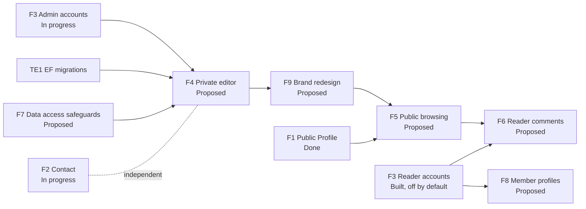

# GooseWebsite: Project Specification and Roadmap

**Audience:** Gustavo, contributors, and AI agents planning work.  
**Last reviewed:** 2026-10-01

This document is the high-level technical specification of GooseWebsite, organized as a Scrum plan. It answers three questions: what are we building technically, in what order, and how do we know each piece is finished.

  Document   Role |
| --- | --- |
| [goal.md](./goal.md) | Why the project exists, in plain language. The ultimate goal. |
| **project.md** (this file) | Technical scope and the Scrum roadmap. |
| [product-backlog.md](./product-backlog.md) | The Product Backlog in detail: every story, acceptance test, and decision. |
| [architecture.md](./architecture.md) | How the code is organized today, with diagrams. Read before changing code. |
| [f3-authentication-architecture.md](./f3-authentication-architecture.md) | Design record for accounts and authentication. |

## 1. Product vision

> A credible public home for Gustavo Couto Vanin where visitors learn who he is, explore his work and selected stories, and reach him safely, and where Gustavo alone controls what is published.

The full statement and principles are in [goal.md](./goal.md). Anything in this plan that conflicts with it is a defect in the plan.

## 2. Technical specification

### 2.1 Solution at a glance

| Concern | Choice |
| --- | --- |
| Shape | One deployable ASP.NET Core application that also serves the Angular client (single origin, no CORS) |
| Backend | ASP.NET Core on .NET 10, organized as a modular monolith (`Accounts`, `Blog`, `Contact` modules over a small shared layer) |
| Frontend | Angular 20 (standalone components, signals), SCSS, built into the API's `wwwroot` |
| Data | SQLite through EF Core; ASP.NET Core Identity for users and roles |
| Sessions | Identity cookie (HttpOnly, SameSite=Lax, Secure in production) with antiforgery tokens on every state-changing request |
| Email | One shared `IMailService` over two transports: SMTP and MailerSend templates |
| Delivery | Docker image, with Caddy as the TLS reverse proxy in `docker-compose.yml` |
| Tests | xUnit integration and unit tests for the API; Jasmine/Karma for the client |

### 2.2 Modules

| Module | Responsibility | Releases |
| --- | --- | --- |
| Accounts | Sign-in and sign-out, roles (`Admin`, `Reader`), authorization policies, operator-only administrator provisioning, reader registration and email verification | R1, R3 |
| Contact | Public contact form, abuse controls (honeypot and rate limit), verification-first delivery | R1 |
| Blog | Posts with draft/publish state; the seed that will grow into Stories and Projects | R1, R2 |
| Shared | `DatabaseService` (the single gateway for all database reads and writes), mail service (`IMailService`) and transports, trusted-proxy headers, module startup hooks | all |
| Client | Public profile and home sections, contact form, blog section, sign-in and verification screens; redesigned in F9 | all |

New product areas (for example Comments and Member Profiles in R3) are added as new modules; see the recipe in [architecture.md](./architecture.md#9-how-to-add-change-or-remove-a-feature).

### 2.3 Quality requirements

These are release gates, taken from the [product backlog](./product-backlog.md) and the architecture decisions.

| Area | Requirement |
| --- | --- |
| Security | Authorization is enforced in the API, never only in the client. Administrator accounts are created only by an operator command. Public registration can never create or elevate an administrator. No credentials, tokens, or message bodies in logs. No secrets in source control. |
| Privacy | No durable message inbox. Pending contact data is deleted after delivery or expiry. Reader email is never returned publicly. Age, exact location, and similar details are never published. |
| Accessibility | WCAG AA contrast, keyboard operable with visible focus, usable at 320 CSS px with no horizontal scroll, reduced-motion respected. |
| Performance | Client bundle stays within the Angular budgets (warning at 500 kB, error at 1 MB initial). Current initial bundle is about 361 kB raw. |
| Maintainability | Features live in their own module. Public contracts are DTOs, never database entities. See the conventions in [architecture.md](./architecture.md#8-conventions). |
| Operability | Same image runs locally and in production; all environment-specific values come from configuration. |

### 2.4 Out of scope

A durable contact inbox, public posting by anyone other than administrators, analytics-driven targets, and OAuth or JWT sign-in.

## 3. Scrum framework

### 3.1 Roles

| Role | Held by | Responsibility |
| --- | --- | --- |
| Product Owner | Gustavo | Owns [goal.md](./goal.md) and the order of the Product Backlog; accepts or rejects finished work; decides visual and content questions. |
| Development Team | Gustavo and AI agents | Build, test, and document each increment. |
| Scrum Master | Gustavo (with agents flagging impediments) | Keeps the process lightweight and the documents current. |

### 3.2 Cadence (proposed)

- **Sprint length:** two weeks (confirmed by Gustavo 2026-10-02). Dates are set at Sprint Planning.
- **Sprint Planning:** pick a Sprint Goal and the stories that serve it. Move stories from `Proposed` to `Ready` only when dependencies and decisions are clear.
- **Daily check-in:** asynchronous. Record impediments in the Sprint Backlog below.
- **Sprint Review:** demonstrate the working increment against the acceptance tests and record evidence in the backlog.
- **Retrospective:** one change to try next sprint. Record it under "Sprint log".

### 3.3 Artifacts

| Scrum artifact | Where it lives |
| --- | --- |
| Product Backlog | [product-backlog.md](./product-backlog.md) (features F1 to F6, stories, acceptance tests) plus the technical enablers in section 6 below |
| Sprint Backlog | Section 5 below: the current sprint's goal and stories |
| Increment | The main line of the repository, deployable as the Docker image |
| Definition of Done | Section 3.4 |

### 3.4 Definitions

**Definition of Ready.** A story is ready when its goal and acceptance tests are written, dependencies are done, open decisions are recorded in the backlog, and its estimate is set (1 US = 12 hours).

**Definition of Done.** A story is done only when all of the following hold.

1. Every acceptance test passes, and the evidence (test name or manual check) is recorded in the backlog.
2. `dotnet test GooseWebsite.slnx` and `npm test -- --watch=false --browsers=ChromeHeadless` (in `src/GooseWebsite.Client`) pass, and the production build succeeds.
3. New behavior has automated tests at the right level (see [architecture.md](./architecture.md#10-testing)).
4. No secrets, personal data, or message content are added to code, config, or logs.
5. The change follows the module conventions and, if structure or contracts changed, [architecture.md](./architecture.md) is updated in the same change.
6. Backlog status, estimate, and decision log are updated.
7. A new feature adds its runtime checks to `verify/runtime/` (one file per feature) and the whole `scripts/verify.ps1` run passes on the container (see section 3.6).

### 3.5 Delivery workflow (decided by Gustavo 2026-10-12)

- **One commit per user story.** A story's code, tests, documentation, and its status and evidence updates go in a single commit, so the history reads as one line per story and a story can be reverted whole. A technical enabler (TE) is committed the same way, one commit per enabler. Do not add separate "mark Done" or "fix docs" commits for a story; amend or fold them into that story's commit before the pull request is opened.
- **One pull request per feature.** All the commits of a feature (F1 to F9) go in one pull request, opened when the feature's stories are ready for review, from a branch named for the feature (for example `f4-private-editor`). The pull request lists its stories and links their specs. Enablers that exist for no single feature (for example TE1 to TE3) each get their own pull request; enablers that serve one feature travel in that feature's pull request.
- **Order of work inside a feature.** Stories land in the order the roadmap gives; each is reviewed (standards and spec) before its commit, and its acceptance tests pass before its status becomes `Done`.
- **Status changes need approval.** A story or enabler moves to `Done` only after Gustavo approves it; until then it stays `In Progress` with the evidence recorded.

### 3.6 Verification environment (decided by Gustavo 2026-10-14)

- **One running environment:** the Docker container stack on Gustavo's machine is the only place the running site exists and is a testing environment. Nothing is deployed, so there is no production to protect.
- **Two checks, in order.** (1) GitHub Actions CI (TE2) is the first check and is maintained like any other part of the product; push the branch and wait for the pull request's checks. (2) Then the code is deployed to the container and everything that needs a running container (runtime tests, health checks) is verified there. CI does not replace the container, and the container does not replace CI.
- **Verification means restarting the container.** After a code change, the agent rebuilds and restarts the stack and reads the results. Enabler TE10 makes that one deterministic command that runs the unit tests of every stack (.NET, Angular, later React), the runtime tests of every feature that exists, and the health checks, and logs each test. TE10 has the highest priority because it speeds up and sharpens every later story.
- **Run it:** `scripts/verify.ps1` (add `-SkipCi` for a branch with no pull request yet). In order it checks the pull request's CI, backs up and resets the stack's data, rebuilds and restarts the containers, provisions two test administrators and exercises the operator commands, then runs the verification container: the .NET tests, the Angular tests, and the runtime tests of every feature. Every test logs one line (`PASS`/`FAIL`/`SKIP`, stage, name, milliseconds); results are in `verify-results/latest.log` and `latest.json`, and the data is left in place afterwards. The run ends with a summary and a non-zero exit code if anything failed.
- **Adding to it:** a new feature adds a file under `verify/runtime/`; a new stack (React) adds a script under `verify/stages/`. Details in `Docs/architecture.md` section 10.

## 4. Roadmap

### 4.1 Releases

| Release | Outcome | Exit measure | Planned effort |
| --- | --- | --- | --- |
| R1: Credible home base | Public profile, verified contact, administrator sign-in, private editor, new brand design | All R1 gates pass; no sensitive fields exposed; only administrators can edit | 36 US (432 h) |
| R2: Explore the work and stories | Public browsing of published projects and stories | Drafts never visible; every published item reachable | 4 US (48 h) |
| R3: Reader conversation | Verified readers comment on projects and stories and share optional profiles | Only verified readers comment; email stays private; authors own their comments | 13 US (156 h) |

Feature and story details, including acceptance tests, are in the [product backlog](./product-backlog.md).

### 4.2 Dependencies

## 5. Sprint plan

Gustavo confirmed on 2026-10-02 a capacity of about 6 US (72 hours) per sprint as the planning assumption; measure the real velocity in Sprint 1 and re-plan. Each line lists the remaining effort, not the original estimate. Order follows dependencies: foundations and trust first, then the data-access safeguards and the editor, then public pages, then comments.

| Sprint | Sprint Goal | Stories and enablers | Effort |
| --- | --- | --- | --- |
| 0 (done, 2026-10-01) | The project is ready to grow | Modular restructure, rename to GooseWebsite, secrets out of config, goal/project/architecture documents | n/a |
| 1 | Contact is truly verified and R1 sign-in is closed out | F2-US2 remaining work (email the link, stop returning it, confirmation page); F3-US1 close-out (production HTTPS runtime checks); F3-US3 administrator recovery; TE1 EF Core migrations; TE2 CI pipeline; TE3 dependency hygiene; TE6 Contact submission module ([#2](https://github.com/GucciVanin/goosevaninWebsite/issues/2)) | about 6 US |
| 2 | Data access is safe by default, and the editor is protected | TE10 container verification ([#12](https://github.com/GucciVanin/goosevaninWebsite/issues/12), first and highest priority); F7-US1 database access safeguards (sanitization and access checks in `DatabaseService`); F4-US2 secure administrator editor; TE7 Reader account registration ([#4](https://github.com/GucciVanin/goosevaninWebsite/issues/4)). F7-US1 starts with the persistence interface design ([#3](https://github.com/GucciVanin/goosevaninWebsite/issues/3)) | 5 US |
| 3 | Gustavo can manage and write content | TE9 decision on a blog authoring module ([#6](https://github.com/GucciVanin/goosevaninWebsite/issues/6)), made before F4-US3; F4-US1 editor workspace; F4-US3 stories | about 5.5 US |
| 4 | Content can be managed; the new brand foundation exists | F4-US4 projects; F4-US5 image upload; F9-US1 brand and design tokens (needs Gustavo's logo SVG and inspiration image) | 6 US |
| 5 | The new design covers the shell and home page | F9-US2 site shell; F9-US3 home page redesign | 5 US |
| 6 | The new design covers every screen and email | F9-US4 contact, blog, and account pages; F9-US5 editor; F9-US6 branded emails; TE8 one Mail module ([#5](https://github.com/GucciVanin/goosevaninWebsite/issues/5)), right after F9-US6 | 6 US |
| 7 | **R1 ships** | F9-US7 accessibility and responsiveness verification; TE5 browser tests and accessibility scan; TE4 remove sample content (deployment gate); R1 release gate (all exit measures) | 4.5 US plus gate |
| 8 | **R2 ships** | F5-US1 projects; F5-US2 stories | 4 US |
| 9 | Readers can converse | F3-US4 reader password reset; F6-US1 comment on content; F6-US2 replies; F6-US3 manage own comments | 6 US |
| 10 | **R3 ships** | F8-US1 create profile with optional details; F8-US2 view another user's profile; F8-US3 edit or remove my details; enable reader registration in production | 5 US plus launch checks |

### Current sprint backlog (Sprint 1, not yet started)

Fill in dates and owners at Sprint Planning. Statuses use the backlog vocabulary (`Proposed`, `Ready`, `In Progress`, `Blocked`, `Done`).

| Item | Status | Notes |
| --- | --- | --- |
| F2-US2: email the verification link, remove token and URL from the response, add confirmation page | Done | Verified end to end 2026-10-06; see the story |
| TE10: one-command container verification ([#12](https://github.com/GucciVanin/goosevaninWebsite/issues/12)) | Done | Implemented 2026-10-14 and approved 2026-10-14 (pull request merged): `scripts/verify.ps1` runs 222 checks (108 .NET, 28 Angular, 86 runtime), all passing; a broken check makes it fail and the CI gate stops it; found and led to the F3-US1 sign-out fix; awaiting approval |
| F4-US3: manage stories as drafts, with TE9 folded in (Sprint 3) | Done | Implemented 2026-10-15: editor API at `/api/editor/stories`, authoring service, publish and unpublish, publication date, Markdown form with preview; approved 2026-10-15 (pull request merged) |
| F4-US1: editor workspace (Sprint 3, projects switch in Sprint 4) | Done | Implemented 2026-10-15: story list with state in words, status filter, title search, empty states, New story, edit links, confirmed deletion; the Projects switch waits for F4-US4; approved 2026-10-15 (pull request merged) |
| F4-US4: manage projects as drafts (Sprint 4) | Done | Implemented 2026-10-16: Projects module, editor API, form with preview, workspace switch; approved 2026-10-16 (pull request merged) |
| F4-US5: upload content images (Sprint 4) | Done | Implemented 2026-10-16: Media module, upload API with content checks, cover image and inline images in both forms; approved 2026-10-16 (pull request merged) |
| F9-US1: brand and design tokens (Sprint 4) | Done | Implemented 2026-10-16: tokens, base components, logo, React island for the animated scene, project panel, GIF uploads, review page at `/design` (removed 2026-10-26 by TE4); approved 2026-10-20 (pull request merged) |
| F9-US2 / F9-US3: shell and home page (started 2026-10-16) | Done | Header, footer, hero, the three category cards and the narrow-screen layout follow the mockup; the page transition between routes was added 2026-10-28 (F9-US2 AC2); accepted 2026-10-29 (pull request merged) |
| F9-US4: contact, stories and account screens in the new design (Sprint 6, started early) | Done | Implemented 2026-10-20: sign-in, confirmation and access-denied screens; contact and stories were done with the home page; accepted 2026-10-29 (pull request merged) |
| F9-US5: editor in the new design (Sprint 6, started early) | Done | Implemented 2026-10-22 through the start-dev process (Reviewer accurate, Security pass, Testing 3x green); AC2 keyboard and 320 px lack automated tests; accepted 2026-10-29 (pull request merged) |
| F9-US6: branded emails (Sprint 6, started early) | Done | Implemented 2026-10-22 through the start-dev process (Reviewer accurate, Security pass, Testing 3x green); real-client check is manual; approved 2026-10-22 |
| TE5: browser tests and accessibility scan (Sprint 7, pulled forward for F9-US7) | Done | Implemented 2026-10-22 through the start-dev process (Reviewer accurate x2, Security pass x2, Testing 3x identical): 509 passed and 17 known per container run; accepted 2026-10-22 |
| F9-US7: accessibility and responsiveness verification (Sprint 7, pulled forward) | Done | Implemented 2026-10-22 through the start-dev process: 567 container checks, 0 known defects; real Edge and Safari by manual checklist; accepted 2026-10-29 (pull request merged) |
| F5-US2: read published stories (Sprint 8, started early) | Done | Implemented 2026-10-28 on branch `f5-public-browsing` (`/stories`, `/stories/:slug`, `?tag=`, home preview, pre-publish reminder); 717 container checks, 0 known defects; accepted 2026-10-29 (pull request merged) |
| F5-US1: explore published projects (Sprint 8, started early) | Done | Implemented 2026-10-28 on branch `f5-public-browsing` (`/projects`, `/projects/:slug`, not-found page); 649 container checks, 0 known defects; accepted 2026-10-29 (pull request merged) |
| F4-US2: secure administrator editor (Sprint 2) | Done | Implemented 2026-10-15: secured `/editor` shell and guard, request interceptor, API access matrix and an architecture test on every write action; 108 .NET and 28 Angular tests pass; approved 2026-10-15 (pull request merged) |
| F7-US1: safeguards beneath the database gateway ([#3](https://github.com/GucciVanin/goosevaninWebsite/issues/3)) | Done | Implemented 2026-10-14 and approved 2026-10-15 (Sprint 2): 95 API tests pass; read filters, write access, text normalization, one click = one unit of work |
| F3-US1: record production HTTPS runtime checks | Done | All implementation tasks are checked; the HTTPS runtime checks (redirect, HSTS, certificate, cookie flags) now run in every container verification (TE10) | Accepted 2026-10-29 (pull request merged).
| F3-US3: administrator recovery command | Done | Implemented and approved 2026-10-12 (`admin reset-password`); 49 API tests pass; reviewed for standards and spec |
| TE1: EF Core migrations replacing `EnsureCreated` | Done | Implemented 2026-10-12: 54 API tests pass; a copy of the local development database was adopted on startup; approved 2026-10-15 (pull request merged) |
| TE2: CI pipeline | Done | Workflow added 2026-10-12; all three jobs green on pull request #9 (the first run caught a `Tests`/`tests` folder-case mismatch on Linux, fixed by renaming the folder to `tests`); approved 2026-10-13 (pull request merged) |
| TE3: dependency hygiene | Done | Implemented 2026-10-12: NU1903 resolved by pinning the patched SQLite engine (`dotnet list package --vulnerable` is clean; 55 API tests pass); `npm audit` fell from 12 findings (2 critical) to 6 high, all in the Karma test-runner chain (dev only, accepted and tracked in architecture.md section 11); Angular updated to 20.3.33 and the CLI to 20.3.39; CI green on pull request #10 (client tests on the regenerated lockfile, API tests, Docker build); approved 2026-10-13 (pull request merged) |
| TE7: Reader account registration module and shared public-link builder ([#4](https://github.com/GucciVanin/goosevaninWebsite/issues/4)) | In Progress | Implemented 2026-10-13: 61 API tests pass; registration rules moved out of the controller; the new module test found and fixed a bug (a missing Reader role left a half-created account and returned a server error); approved 2026-10-15 (pull request merged) |
| TE6: deepen the Contact submission flow ([#2](https://github.com/GucciVanin/goosevaninWebsite/issues/2)) | Done | Implemented and approved 2026-10-09: 44 API tests pass, all request-level contact tests unchanged; reviewed for standards and spec |

### Sprint log

| Sprint | Result | Retrospective change |
| --- | --- | --- |
| 0 | Restructured into modules; 20 API tests and 2 client tests pass; Docker image builds and serves the app | Keep documents and code changes in the same change |

## 6. Technical enablers

Enablers are work that is not a product feature but that the features depend on. They are sized with the same effort unit. All estimates are proposed and need confirmation.

| ID | Enabler | Why now | Estimate |
| --- | --- | --- | --- |
| TE1 | Replace `EnsureCreated` with EF Core migrations and baseline the existing database | The editor (F4) changes the schema; `EnsureCreated` cannot evolve an existing database | 1 US |
| TE2 | CI pipeline: build, run both test suites, build the Docker image | Nothing currently stops a regression from merging | 1 US |
| TE3 | Dependency hygiene: resolve the `SQLitePCLRaw.lib.e_sqlite3` high-severity advisory (NU1903) and run `npm audit` | The build already warns about the advisory | 0.5 US |
| TE4 | Remove sample content: the hard-coded posts in the blog section, placeholder "selected work", and the demo posts in local databases. Gustavo: leave in place during development, remove before deployment | R1 requires no sample content; this is a deployment gate in Sprint 4 | 0.5 US. Done 2026-10-26: the Stories section loads from `/api/blog` only (empty and failure states, categories from the data, Markdown reading view), the `/design` page is removed, a repository sweep found no other sample content, and the operator note for demo posts in local databases is in `Docs/architecture.md` section 11. Amended 2026-10-27 (Gustavo): the unverified statements (Skills section, About lede and principles, Stories intro) are removed and the four category cards become three (Projects, Life stories, Competitions), TE4-AC6 and AC7 |
| TE5 | Browser tests and an automated accessibility scan | Several acceptance tests (320 px, keyboard, contrast) are manual today | 2 US |
| TE6 | Deepen the Contact submission flow: one module owns checks, Verification link, delivery and retry; the controller only maps outcomes ([#2](https://github.com/GucciVanin/goosevaninWebsite/issues/2)) | The retry and restore rules can only be tested through HTTP today | 1 US |
| TE7 | Deepen Reader account registration and share one public-link builder ([#4](https://github.com/GucciVanin/goosevaninWebsite/issues/4)) | Registration rules sit in the controller; F3-US4 would copy them | 1 US |
| TE8 | One Mail module replacing the SMTP and MailerSend seams ([#5](https://github.com/GucciVanin/goosevaninWebsite/issues/5)) | The same failure and privacy rules are written twice; do after F9-US6. **Status 2026-10-28: implemented (Gustavo chose approach B), awaiting verification evidence and Captain close; not Done.** | 1 US |
| TE9 | Blog authoring module for Stories and Projects ([#6](https://github.com/GucciVanin/goosevaninWebsite/issues/6)); speculative, may merge into F4-US3 | Slug, tag and timestamp rules are in the controller | 0.5 US |
| TE10 | One-command container verification: unit tests of every stack, runtime tests of every feature, health checks, one log line per test ([#12](https://github.com/GucciVanin/goosevaninWebsite/issues/12)). Highest priority | The container is the only environment, and nothing verified a change there | 1.8 US |

Enablers total 10.3 US (124 hours) and are in addition to the 53.5 US of product features. TE6 to TE9 and the F7-US1 design task come from the architecture review of 2026-10-06; each has a spec in GitHub Issues and ranks ahead of feature work where its dependencies allow.

## 7. Risks and open decisions

| Item | Impact | Next step |
| --- | --- | --- |
| SMTP credentials were committed to `appsettings.json` and `CLAUDE.md` before 2026-10-01 | Anyone with the repository or a copy can send mail as the sender | Rotate the MailerSend key and password; the values in git history stay exposed if a repository is ever created from earlier copies |
| Pending contact messages live in memory | Lost on restart; works only with one instance | Acceptable for R1 (matches the no-inbox decision); revisit if the site scales out |
| The logo and inspiration image for the redesign (F9) were supplied on 2026-10-02, but the hero illustration file and the GitHub and LinkedIn URLs are still missing; the logo is a raster PNG inside an SVG | F9-US1 and F9-US3 cannot be Ready without them | Gustavo to provide the remaining items before Sprint 4 |
| The redesign is built after the editor, so F4 screens are first built in the current look | Some rework in F9-US5 | Accepted by Gustavo (design after R1 features, before launch); keep editor styles on shared tokens where possible |
| Accessibility is verified after the redesign rather than during it | A late finding could delay R1 | F9-US7 is a launch gate; run the automated scan (TE5) early in F9 |
| Decisions listed at the end of the backlog (image formats and limits, URL and deletion behavior, browser matrix) | Block F4-US5, F5, and F6 stories from becoming `Ready` | Decide before the sprint that needs them |

## 8. Ideas parked for later

These came from the earlier "Plan to Stand Out" and are not committed. They are archived in full in `Docs/archive/plan.md`. Promote an item into the Product Backlog only with a goal and acceptance tests.

- Real case studies with decisions and measurable outcomes (this is what the Projects feature in F4 and F5 will hold).
- A "now" page, a downloadable resume generated from the same profile data, and verified testimonials.
- Page metadata, structured data, a sitemap, and an RSS feed for stories.
- A lightweight interactive architecture playground as a signature feature.
- Visual regression snapshots and Lighthouse checks in CI (extends TE2 and TE5).

Items from that plan that conflict with the confirmed decisions, such as a durable contact store and consent handling for a stored inbox, are intentionally dropped.
